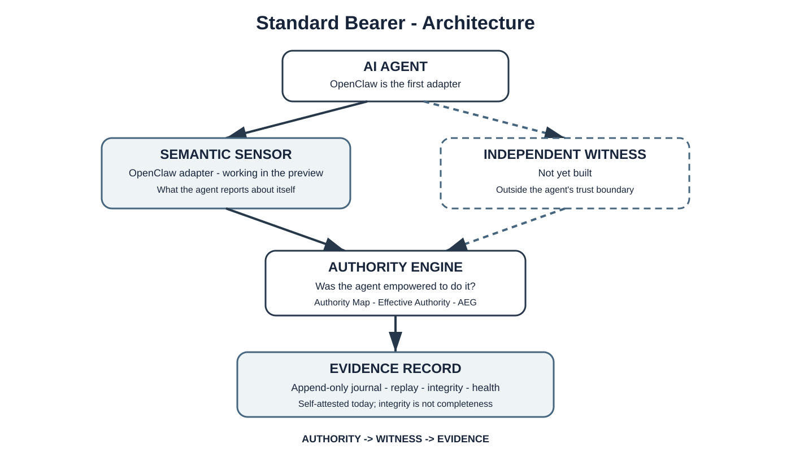

<p align="center">
  <picture>
    <source media="(prefers-color-scheme: dark)" srcset="assets/standard-bearer/sb-lockup-standalone-reverse.svg">
    
  </picture>
</p>

<p align="center"><strong>See what authority your AI agent actually has - and what changed.</strong></p>

> **Standard Bearer Observer v0.1 - research release.** It evaluates **recorded, synthetic** OpenClaw deployment snapshots offline. It does not monitor a live agent, does not provide an independent witness, does not execute financial transactions, and does not enforce anything. See [Current limitations](#current-limitations).

## The problem

An AI agent's authority is spread across runtime configuration, tools, plug-ins, sandboxes, approval rules and deployment settings. No single place shows what the agent can actually do. So an agent can hold more technical authority than its owner intended, even while it is functioning normally, and nobody notices until it uses it.

## What Standard Bearer Observer does

The Observer reads a recorded snapshot of an agent deployment and answers one question: **does the authority this deployment actually grants exceed the authority its owner declared?**

- **Declared authority** - what the owner says the agent may do (for example, read and write `/workspace`).
- **Effective authority** - what the recorded configuration actually allows: filesystem reach, shell execution, elevated execution and network access.
- **Observation completeness** - whether every required authority dimension was observed. `COMPLETE`, `PARTIAL` or `UNKNOWN`.
- **Authority Exposure Gap (AEG)** - the difference between the two:
  - `NONE` - complete observation, and effective authority stays within declared authority.
  - `HIGH` - complete observation, and effective authority exceeds declared authority.
  - `UNKNOWN` - the observation is incomplete, so no reliable conclusion is possible. An incomplete observation is never reported as `NONE`.

OpenClaw is the first agent framework supported. It is the proving ground, not the product boundary.

## Quick start

Requirements: Node.js 20 (tested with 20.18.0) and pnpm 10.28.1, which Corepack selects from `package.json`.

```sh
git clone https://github.com/ConcordMeridian/standard-bearer-public.git
cd standard-bearer-public

corepack enable
pnpm install --frozen-lockfile
pnpm build

node packages/cli/dist/index.js replay 06-sandbox-mismatch --fixture unexpectedly-elevated
```

Output:

```text
STANDARD BEARER

Agent
  openclaw:coder

Deployment
  local-dev-elevated (development)

Authority Exposure Gap
  HIGH

Observation Completeness
  COMPLETE

Unexpected Authority
  + /home/user READ
  + shell execution
  + elevated execution
  + unrestricted network

Declared Authority

  Filesystem
    /workspace           READ / WRITE

Observed Effective Authority

  Filesystem
    /workspace           READ / WRITE
    /home/user           READ

  Execution
    shell                ALLOWED
    elevated             ALLOWED

  Network
    internet             UNRESTRICTED
```

The owner declared `/workspace` only. The recorded deployment also allows reads of `/home/user`, shell and elevated execution, and unrestricted network access. That difference is the Authority Exposure Gap. The agent is not misbehaving; it simply has more authority than intended.

## Reproduce the examples

Scenario 06 (sandbox / elevated execution mismatch) has three synthetic fixtures in [`scenarios/06-sandbox-mismatch`](scenarios/06-sandbox-mismatch/README.md). Each result is computed by the authority engine; the approved outputs in `scenarios/06-sandbox-mismatch/expected/` are checked byte-for-byte by the tests.

| Outcome | Command | Result |
| --- | --- | --- |
| NONE | `node packages/cli/dist/index.js replay 06-sandbox-mismatch --fixture tightly-bounded` | AEG `NONE`, completeness `COMPLETE` |
| HIGH | `node packages/cli/dist/index.js replay 06-sandbox-mismatch --fixture unexpectedly-elevated` | AEG `HIGH`, completeness `COMPLETE`, four unexpected capabilities |
| UNKNOWN | `node packages/cli/dist/index.js replay 06-sandbox-mismatch --fixture incomplete` | AEG `UNKNOWN`, completeness `PARTIAL`, observer health `DEGRADED` |

Run all three in order:

```sh
node packages/cli/dist/index.js replay 06-sandbox-mismatch
```

In the `incomplete` fixture, elevated execution and network settings were not recorded. The Observer reports `Unexpected Authority: NOT DETERMINABLE` and lists the missing dimensions instead of guessing.

## Inspect the evidence

Every result is rebuilt from an evidence journal, not computed directly from the snapshot:

1. The OpenClaw sensor converts the snapshot into four evidence events: `agent.discovered`, `authority.declared`, `permission.snapshot` and `observer.health.changed`.
2. Each event carries a stable ID, a per-collector sequence number and a SHA-256 hash of its canonically serialized payload.
3. The journal appends the events. The Authority Map is then rebuilt by replaying the journal.

The CLI does not yet have an inspection command. After `pnpm build`, run this from the repository root to replay the journal, verify it, rebuild the result twice and show tamper detection:

```sh
node --input-type=module <<'JS'
import { readScenario06Fixture } from "./packages/cli/dist/commands.js";
import { ScenarioOpenClawAdapter } from "./packages/sensor-openclaw/dist/index.js";
import { InMemoryEvidenceJournal } from "./packages/evidence/dist/index.js";
import { AuthorityProjector, serializeAuthorityMap } from "./packages/authority/dist/index.js";

const fixture = readScenario06Fixture("unexpectedly-elevated");
const { agentId, deploymentId } = fixture.snapshot;

const journal = new InMemoryEvidenceJournal();
for (const event of new ScenarioOpenClawAdapter().toEvidenceEvents(fixture)) await journal.append(event);

const history = [];
for await (const event of journal.stream()) {
  history.push(event);
  console.log(event.sequence.toString(), event.type, event.evidenceMode, event.payloadHash);
}

console.log("integrity", await journal.verify());
const first = serializeAuthorityMap(new AuthorityProjector().rebuild(history, agentId, deploymentId));
const second = serializeAuthorityMap(new AuthorityProjector().rebuild(history, agentId, deploymentId));
console.log("replay identical:", first === second);
console.log("AEG:", JSON.parse(first).exposureGap.status);

const tampered = structuredClone(history[2]);
tampered.payload.controlState.elevatedExecution = false;
try {
  await new InMemoryEvidenceJournal().append(tampered);
} catch (error) {
  console.log("tampered event rejected:", error.name, "-", error.message);
}
JS
```

Output:

```text
1 agent.discovered self_attested sha256:d39d244c7263734c510198f0570fd2de9c87e3f10fea9127e91fa3c9a0db705a
2 authority.declared self_attested sha256:e69bce7fdd5c8c0b2643d880c2d05c4c25e8c6a0e4b4ae43501b79dfa2e01985
3 permission.snapshot self_attested sha256:64991969fdc4931ea2019e09fcb039faee8a6bb34c8952808d5f7d6081447c98
4 observer.health.changed self_attested sha256:efa1086ab54f2190ed4d3ff12a89723aa30b92c7ede3538fd406f8e4e6e3d145
integrity { valid: true, eventCount: 4, issues: [] }
replay identical: true
AEG: high
tampered event rejected: InvalidEvidenceEventError - Evidence payload hash mismatch: openclaw-config:local-dev-elevated:3:permission.snapshot
```

The journal detects these cases, and each one is covered by the tests:
- A payload that no longer matches its hash.
- A reused event ID with different content.
- An event that arrives out of sequence.
- A gap in a collector's sequence. A gap is recorded as degraded observer health, which turns the result into `UNKNOWN`.

### Integrity is not independence

These checks establish **integrity**, in a narrow sense: each event's payload still matches its own hash, and per-collector sequence numbers are contiguous. They do not establish **independence**, and they are weaker than they may look:

- **The journal is not a hash chain.** Each event hashes only its own payload. Events are not linked to one another, and the journal is not signed or sealed.
- **The envelope is not hashed.** Event type, timestamps, identifiers and the `evidenceMode` label sit outside the hash. The protocol accepts the labels `observed`, `sealed` and `witnessed` from any producer without verifying them. A record relabelled `witnessed` passes every check, so the label is only a claim.
- **What goes undetected:**
  - Anyone who can write to the record can change a payload and recompute its hash, and the result passes every check.
  - Events dropped from the end of a sequence leave no gap, so the loss is invisible.
  - An event that was never recorded is invisible too.
- **The source is not independent.** The Semantic Sensor that produced the events runs inside the observed agent's trust boundary. A reproducible, internally consistent journal can still describe a configuration that the agent influenced, or one that is incomplete.

Deterministic replay shows that the same evidence always yields the same conclusion. It does not show that the evidence is true, complete, or beyond the agent's reach. Independent witnessing is the part of the architecture intended to address that, and it is not implemented.

## Run the tests

```sh
pnpm test
```

This compiles the packages and runs 25 tests:
- protocol and schema validation
- sensor normalization
- authority and AEG semantics
- journal integrity and tampering
- deterministic replay
- CLI golden outputs
- architecture boundaries

The run fails unless every compiled file has 100% line, branch, function and statement coverage.

```sh
pnpm gate
```

This runs the publication gate over the files Git would publish, checking for secret-like content, forbidden files, required license files and links.

## Current limitations

- **Recorded input only.** The Observer evaluates synthetic snapshot fixtures. **Live agent monitoring is not implemented.**
- **Self-attested evidence only.** The Semantic Sensor reports what the agent's configuration says about itself, from inside the observed environment's trust boundary. The agent may have the technical ability to influence what the sensor observes. **Independent witnessing is not implemented**, and no evidence confidence level is assigned.
- **In-memory journal.** Evidence is held in memory for the run; there is no persistent store.
- **Integrity is not independence or completeness.** Per-event hashes are not a hash chain or a signature. They do not protect against anyone who can rewrite the record and its hashes together, and they do not show that nothing was omitted. See [Integrity is not independence](#integrity-is-not-independence).
- **No enforcement.** Standard Bearer does not block, permit or change anything an agent does. **No production authorization enforcement is provided.**
- **No financial execution.** There is no banking, payment or money-movement capability.
- **One scenario.** Only Scenario 06 and five authority dimensions (workspace filesystem, broader filesystem, shell execution, elevated execution, network) are covered. Tracking authority changes over time is not built.

## Architecture

```text
Recorded OpenClaw snapshot (synthetic fixture)
        |
        v
Semantic Sensor (OpenClaw adapter)        self-attested; inside the agent's trust boundary
        |  evidence events
        v
Evidence Journal (append-only, in memory) stable IDs, sequences, per-event SHA-256 payload hashes
        |  replay
        v
Authority Evaluation                      effective authority, completeness, AEG
        |
        v
Report (CLI)
```

The journal is the source of truth. The Authority Map and its AEG are derived state, rebuilt from the journal on every run, and must come out byte-for-byte identical on every replay.

Standard Bearer separates three concerns: **AUTHORITY -> WITNESS -> EVIDENCE**.

- **Authority** - what is this agent allowed to do? Declared authority, effective authority and the gap between them.
- **Witness** - what did this agent do? Today the only source is the **Semantic Sensor**. It shares the agent's trust boundary, so it is not an independent witness. An independent witness is not built.
- **Evidence** - can the record be trusted? An append-only record with replay and integrity checks. All evidence in Observer v0.1 is self-attested.



## Evidence confidence

Standard Bearer distinguishes **self-attested** evidence, reported by software inside the observed agent's trust boundary, from **independently witnessed** evidence, collected by controls the agent cannot modify, disable, impersonate or bypass without detection. Only the first kind exists today.

> **The agent should not possess the authority necessary to interfere with its observer.**

That is a design objective. This release does not achieve it: the Semantic Sensor runs inside the boundary it observes.

## Feedback

If you build or run AI agents, or study how authority is delegated to them, please open a [GitHub issue](https://github.com/ConcordMeridian/standard-bearer-public/issues) for:

- Authority mappings you believe are wrong.
- OpenClaw configurations the Observer does not support.
- Observations reported as incomplete that should not be, or the reverse.
- Results you could not reproduce.

**Do not post real deployment configurations, credentials, tokens, hostnames or other confidential details in public issues.** Reduce the problem to a synthetic example. To report a security concern, see [SECURITY.md](SECURITY.md).

---

Copyright 2026 Vijay Harrell. Licensed under the [Apache License, Version 2.0](LICENSE); see also [NOTICE](NOTICE).

The Standard Bearer name and logos are not licensed under the Apache License; they are covered by [TRADEMARKS.md](TRADEMARKS.md).
